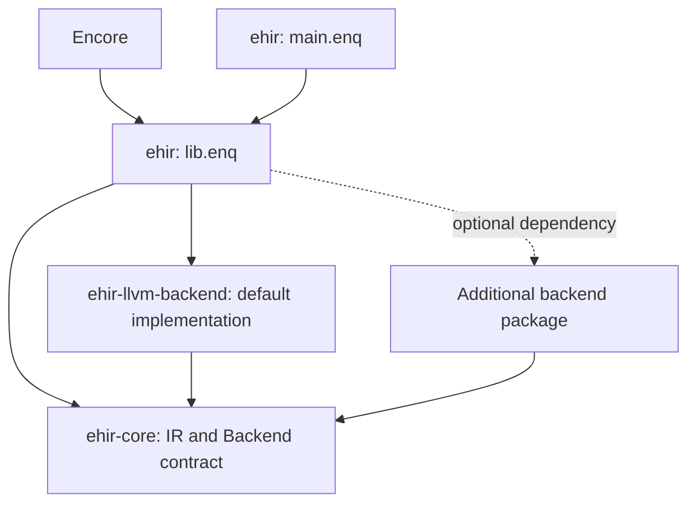

# EHIR compiler

The package provides one compiler as a library and a command-line application.
`src/main.enq` handles CLI arguments and diagnostics. `src/lib.enq` exports the
compiler API. Encore calls this API directly without launching the EHIR CLI.
The dependency/import name remains `ehirlib`; `binary-name = "ehir"` selects the
executable name independently.



Backends are ordinary package dependencies, linked into the same process. LLVM
is the default. A custom package implements `ehir_core::Backend` and is passed
to `compile_with_backend` or `compile_prepared_with_backend`. The CLI lists its
registered implementations with `--list-backends`; the current CLI registers
LLVM only. The separate inspection backend in the integration fixtures verifies
that extension packages need neither the compiler facade nor LLVM dependencies.

## CLI

```sh
encore build
./target/dev/ehir input.ehir --emit llvm-ir -o output.ll
./target/dev/ehir input.ehir --backend llvm --emit obj -o output.o
```

The CLI accepts a single module's declarations or an `entry`/`module` bundle.
Options include `--target`, `--profile`, `--jobs` and `--cc`. Compilation defaults
to the host, dev profile and available parallelism. `--cc` names a native compiler
executable; arguments are passed without a shell. Object emission uses Clang,
publishes the complete object atomically and preserves existing output on error.
Application linking and runtime selection remain Encore's responsibility.

## Library

`parse_text` returns a structured input bundle. `prepare` verifies and transforms
it into `PreparedProgram`; `compile_prepared` emits it without repeating those
transformations. `compile` combines these steps with the default backend.
Functions return `Result` with a diagnostic stage and message; they do not exit
the caller on invalid input.

Canonical backend inputs use indexed SSA values with mandatory `TypeId`s.
Selectors for fields and enum variants are separate from SSA values. LLVM's
compatibility adapter materializes its internal instruction representation from
these typed records, without recovering missing value types from text.

`prepare_with_store` reuses versioned binary function records through a host's
`PreparedFunctionStore`. The host supplies keys binding the fully typed body,
compiler/pass versions, target, profile and features. Common preparation reads
only that function; declaration layouts and templates remain inputs to backend
analysis and object identities. Encore's
adapter uses its existing locked, verified packed CAS and cache pruning. Missing
or corrupt records are recomputed; async modules retain complete preparation so
generated coroutine declarations remain consistent. Timing reports expose
`prepared_functions_checked`, `prepared_functions_reused` and
`prepared_modules_fallback`.
